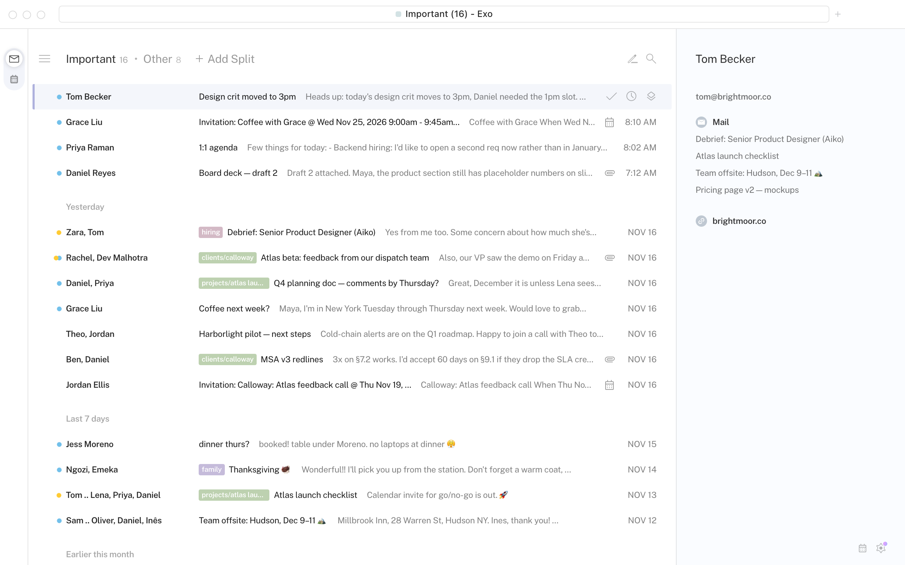

# Exo

A fast, local and native Gmail client for macOS, (heavily) inspired by Superhuman.

It talks to Gmail directly (no third-party servers!) and uses native technologies for maximum performance (written in Rust, no Electron or webview overhead).

<picture>
  <source media="(prefers-color-scheme: dark)" srcset=".github/screenshot-dark.png">
  
</picture>

## Install

1. Download the `.dmg` from the [latest release](https://github.com/m1guelpf/Exo/releases/latest).
2. Open it and drag Exo into Applications.

You'll need to create your own Google sign-in client to use Exo. See below on how to do that (it's free and takes only a few minutes).

### Setting up your Google client

1. Create a project in the [Google Cloud console](https://console.cloud.google.com/projectcreate).
2. Enable the [Gmail API](https://console.cloud.google.com/apis/library/gmail.googleapis.com), the [Google Calendar API](https://console.cloud.google.com/apis/library/calendar-json.googleapis.com) and the [People API](https://console.cloud.google.com/apis/library/people.googleapis.com) for that project.
3. Open [Google Auth Platform](https://console.cloud.google.com/auth/overview) and click **Get started**. Name the app Exo, pick your address as the support email, choose **External** as the audience and finish.
4. In [Audience](https://console.cloud.google.com/auth/audience), click **Publish app**. (You can keep it in Testing, but Google will sign you out every 7 days, which is annoying).
5. In [Clients](https://console.cloud.google.com/auth/clients), click **Create client**, choose **Desktop app** as the application type and create it. Download its JSON file.
6. Move the file into Exo's folder:

```sh
mkdir -p ~/Library/Application\ Support/Exo
mv ~/Downloads/client_secret_*.json ~/Library/Application\ Support/Exo/google-oauth-client.json
```

7. Open Exo and sign in with Google. Google warns that it hasn't verified the app, which is expected for an app you made yourself. Click **Advanced**, then **Go to Exo (unsafe)**, and allow every permission Exo asks for. Exo asks Google for permission to:

- read, send and organize your mail
- change mail settings, such as filters, signatures and the vacation responder
- manage your calendars
- read your contacts and your organization's directory

If you untick any of them on Google's screen, sign-in fails.

## Building from source

You'll need Rust 1.98 or later, Xcode 26 and Ruby 4.0 with Bundler.

```sh
bundle install
bundle exec fastlane build
open target/release/Exo.app
```

A local build is signed ad hoc, so macOS might ask you for Keychain access after each rebuild.
You can optionally set a signing identity with `EXO_SIGN_IDENTITY` to avoid that.

Run `cargo test --workspace` to run the tests. They use a mock Gmail server (`crates/gmail-mock`), so they never hit Google's servers.

## Use of AI

Exo was built almost entirely using automated code-generation tools, mainly _Claude Opus 5.5_. No human has reviewed the generated code for correctness or security. I have extensively tested the app and use it as my daily driver, but there might be issues that I haven't encountered yet.

## License

Exo is released under the [MIT License](LICENSE).
The fonts, icons and photos it bundles, and the code it ports from other projects, are listed with their licenses in [THIRD_PARTY_NOTICES.md](THIRD_PARTY_NOTICES.md).
